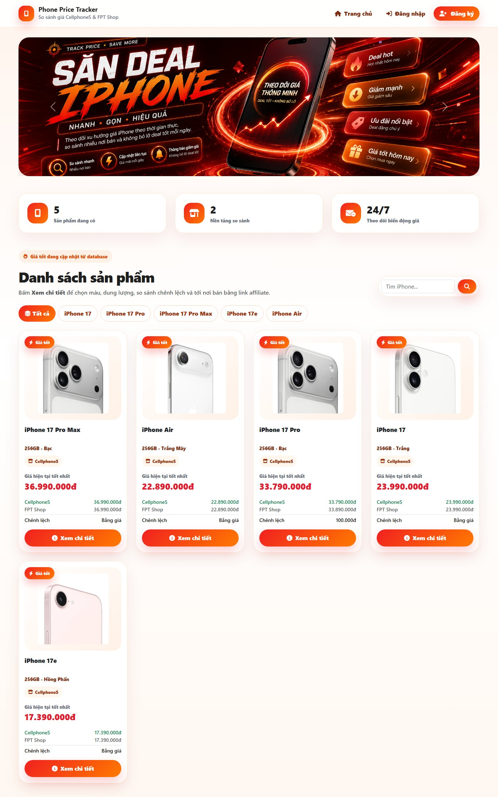
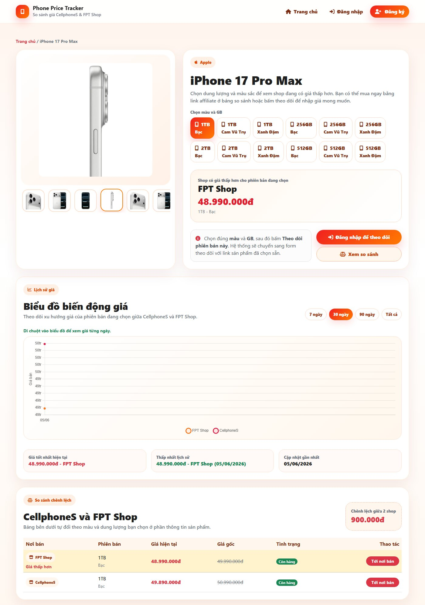

<div align="center">

# 📱 Phone Price Tracker

**Hệ thống theo dõi và so sánh giá iPhone 17 giữa CellphoneS và FPT Shop**

Tự động thu thập giá, lưu lịch sử biến động, so sánh chênh lệch giữa 2 sàn và gửi email khi giá chạm mức người dùng mong muốn.


</div>

---

## 🖼️ Giao diện

| Trang chủ | Chi tiết sản phẩm |
|:---:|:---:|
|  |  |
| Danh sách dòng iPhone 17, giá tốt nhất và chênh lệch giữa 2 sàn | Chọn màu/dung lượng, biểu đồ lịch sử giá, bảng so sánh CellphoneS ↔ FPT Shop |

## ✨ Tính năng chính

**Người dùng**
- 🔍 **So sánh giá 2 sàn** cho từng phiên bản (màu × dung lượng) của iPhone 17, 17 Pro, 17 Pro Max, 17e, Air.
- 📈 **Biểu đồ lịch sử giá** (7 / 30 / 90 ngày) và giá thấp nhất từng ghi nhận.
- 🔔 **Theo dõi giá mong muốn**: nhập mức giá, hệ thống gửi email ngay khi giá hiện tại ≤ mức đó.
- 🔐 **Đăng ký / đăng nhập**, quên mật khẩu bằng **mã OTP qua email**.
- 🛒 Chuyển tới nơi bán qua **link affiliate** và ghi nhận lượt click.

**Quản trị (Admin)**
- Dashboard thống kê, quản lý sản phẩm, link sản phẩm, người dùng, cảnh báo giá, yêu thích.
- Quản lý link affiliate kèm giá hiện tại, **xuất CSV**, trang báo cáo.

**Bot thu thập giá (crawler)**
- Lấy giá từ trang sản phẩm bằng nhiều lớp: dữ liệu **JSON-LD**, JSON nhúng trong trang và phân tích **DOM**.
- **Chống lấy nhầm giá**: bỏ qua giá dưới 1.000.000đ, giá phụ kiện và giá trả góp.
- Mỗi vòng chạy: crawl giá → cập nhật `store_prices` + ghi `price_history` → tạo link affiliate → kiểm tra và gửi email cảnh báo.

## 👩‍💻 Vai trò của tôi

Đồ án nhóm môn **Phát triển ứng dụng web**. Tôi phụ trách **phân hệ quản trị (Admin)**:

- **Dashboard** thống kê tổng quan: số sản phẩm, người dùng, link đang theo dõi, cảnh báo giá.
- **CRUD** sản phẩm, link sản phẩm theo từng sàn, người dùng, cảnh báo giá và danh sách yêu thích (Laravel resource controller).
- **Quản lý link affiliate** kèm giá hiện tại, **xuất CSV** và **trang báo cáo**.
- Phân quyền truy cập khu vực admin bằng middleware `auth` + `admin`.

Mã nguồn chính: [`app/Http/Controllers/Admin/`](app/Http/Controllers/Admin), [`resources/views/admin/`](resources/views/admin).

## 🏗️ Kiến trúc

```
                 ┌──────────────────────────┐
  CellphoneS ───►│                          │      ┌────────────────┐
                 │  ProductPageCrawler      │─────►│ store_prices   │
  FPT Shop   ───►│  (JSON-LD · JSON · DOM)  │      │ price_history  │
                 └──────────────────────────┘      └───────┬────────┘
                              ▲                            │
          php artisan prices:run-cycle                     ▼
                                              ┌───────────────────────────┐
                                              │ PriceCompareService       │──► Web (Blade + Chart.js)
                                              │ PriceAlertNotification    │──► Email cảnh báo (SMTP)
                                              │ AffiliateLinkService      │──► Link affiliate + log click
                                              └───────────────────────────┘
```

**Cơ sở dữ liệu chính:** `products` → `product_variants` (màu, dung lượng) → `store_prices` (giá từng sàn) → `price_history`; cùng `users`, `price_alerts`, `favorites`, `affiliate_click_logs`.

## 🧰 Công nghệ

| Phần | Công nghệ |
|---|---|
| Backend | PHP 8.2, Laravel 12 (Eloquent, Query Builder, Artisan Commands, Mail, Scheduler) |
| Frontend | Blade, Bootstrap 5, Font Awesome, Chart.js |
| Cơ sở dữ liệu | MySQL / MariaDB |
| Thu thập dữ liệu | Laravel HTTP Client, DOMDocument, Regex |
| Email | SMTP (Gmail App Password) |

## 🚀 Cài đặt và chạy

**Yêu cầu:** PHP 8.2+, Composer, MySQL/MariaDB (ví dụ XAMPP) chạy ở cổng `3306`.

```bash
git clone https://github.com/Vananh006/cellphones-price-tracker.git
cd cellphones-price-tracker
composer install
cp .env.example .env
php artisan key:generate
```

Import dữ liệu mẫu (tạo database `phone_price_tracker`):

```bash
mysql -u root -h 127.0.0.1 -P 3306 < database.sql
```

> ⚠️ `database.sql` sẽ **xóa và tạo lại** database `phone_price_tracker` nếu đã tồn tại.

Chạy web:

```bash
php artisan serve
```

Mở http://127.0.0.1:8000

**Trên Windows** có sẵn các file chạy nhanh:

| File | Chức năng |
|---|---|
| `00_SETUP_LAN_DAU.bat` | Cài thư viện, tạo `.env`, APP_KEY, import database |
| `04_START_ALL.bat` | Mở web + bot cào giá nền cùng lúc |
| `05_TEST_CRAWL_1_VONG.bat` | Chạy thử 1 vòng cào giá |
| `06_KIEM_TRA_DATABASE.bat` | Xem số link đã có giá, số dòng lịch sử |

### Lệnh Artisan

```bash
php artisan prices:run-cycle --limit=10      # 1 vòng: crawl giá → affiliate → gửi email cảnh báo
php artisan alerts:check-prices --dry-run    # Kiểm tra cảnh báo giá, không gửi email
php artisan products:crawl --limit=5         # Chỉ crawl giá
php artisan affiliate:generate               # Tạo link affiliate
```

Bật chạy tự động mỗi phút: đặt `CRAWLER_AUTO_ENABLED=true` trong `.env` rồi chạy `php artisan schedule:work`.

### Cấu hình gửi email

```env
MAIL_MAILER=smtp
MAIL_HOST=smtp.gmail.com
MAIL_PORT=587
MAIL_USERNAME=your_email@gmail.com
MAIL_PASSWORD=your_app_password
MAIL_ENCRYPTION=tls
MAIL_FROM_ADDRESS=your_email@gmail.com
MAIL_FROM_NAME="Price Tracker"
```

## 📂 Cấu trúc thư mục

```
app/
├── Console/Commands/      # alerts:check-prices
├── Http/Controllers/      # Trang người dùng, xác thực, theo dõi giá
│   └── Admin/             # Dashboard, CRUD, báo cáo, xuất CSV
├── Mail/                  # OTP, giá đạt mục tiêu, giá thấp nhất lịch sử
├── Models/                # Product, ProductVariant, StorePrice, PriceHistory, PriceAlert...
└── Services/              # Crawler, so sánh giá, gửi cảnh báo, affiliate, ảnh sản phẩm
resources/views/           # Giao diện Blade
routes/web.php             # Route web
routes/console.php         # Lệnh crawl và lịch chạy tự động
database.sql               # Dữ liệu mẫu iPhone 17 (sản phẩm, biến thể, giá, lịch sử)
```

## ⚠️ Lưu ý

Giá được thu thập từ website công khai của CellphoneS và FPT Shop phục vụ mục đích học tập. Khi các trang này thay đổi giao diện, bộ crawler có thể cần cập nhật lại.
